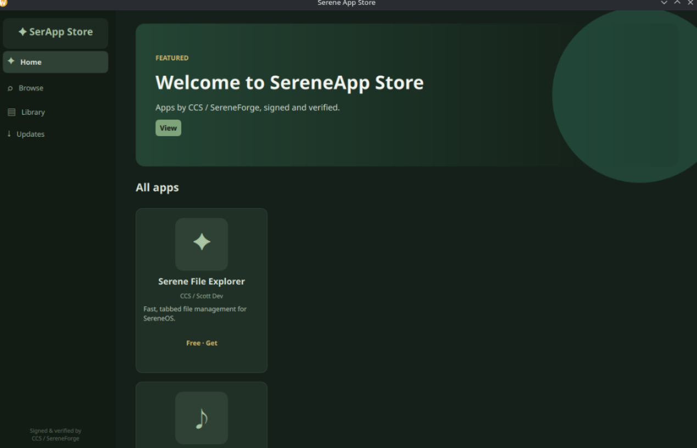
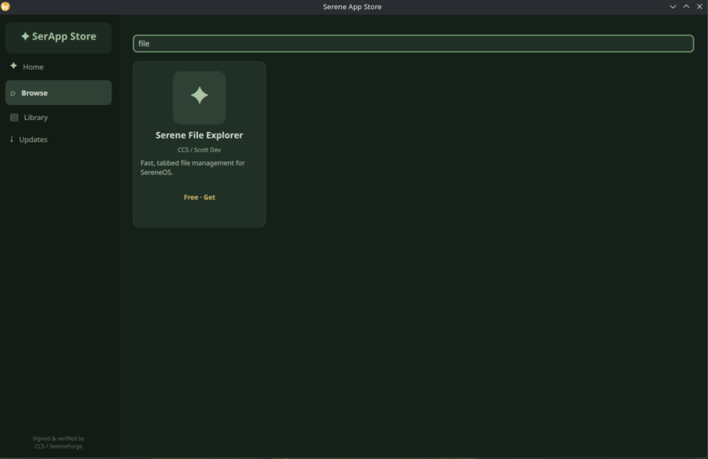
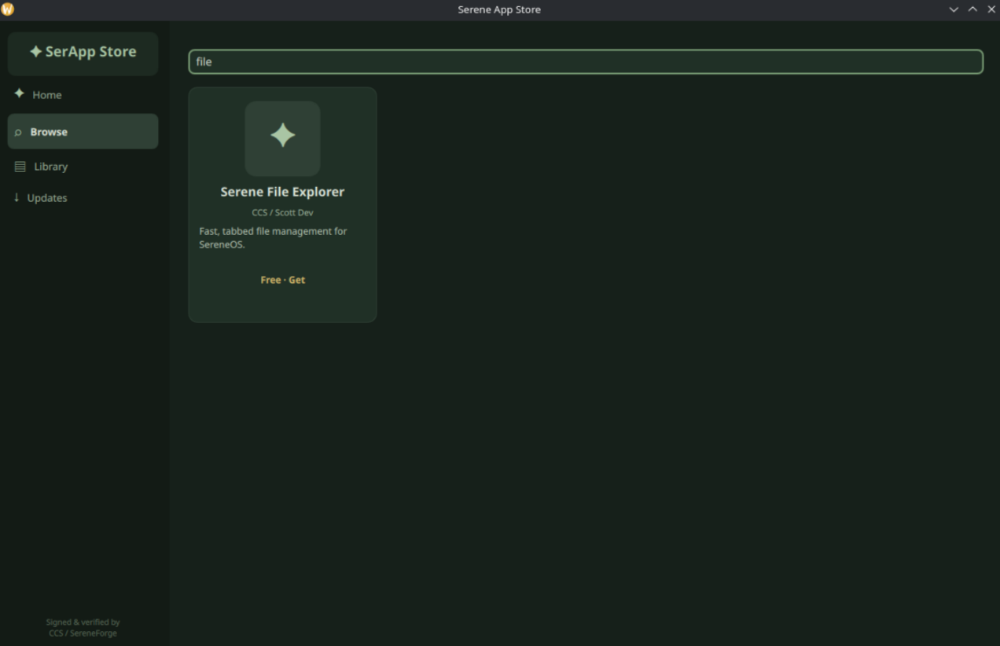
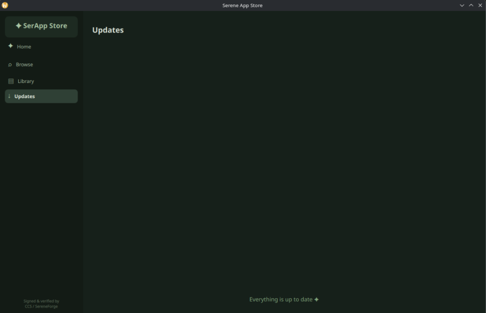

# SerApp_Store

App store client for SereneOS — distributes apps by CCS / SereneForge.ORG and remote maintainers.
Windows Store-inspired UX with a distinct SereneOS identity.

  
<table>
<tr>

  

  

 <h4></h4> 
  
</td>

   

  
 <i></i>

 <h4></h4>
  
  
 
 
 
  

## Build (KDE Neon / Linux)

    sudo apt install qt6-base-dev qt6-declarative-dev qt6-network-dev \
                     qt6-quickcontrols2-dev qt6-concurrent-dev cmake ninja-build libssl-dev
    cmake -B build -G Ninja -DCMAKE_BUILD_TYPE=Release
    cmake --build build
    ./build/SereneAppStore

## Dev-friendly testing

Point `SERENE_STORE_ROOT` at a scratch dir so installs never touch `/opt`:

    mkdir -p ~/tmp/store-root
    SERENE_STORE_ROOT=~/tmp/store-root ./build/SereneAppStore

## Security model

- Every `.serapp` manifest carries an **Ed25519 detached signature**.
- Verification is **fail-closed**: one bad signature rejects the whole index.
- Trust anchor **pinned** in `src/SignatureVerifier.cpp` — never loaded from
  disk/network.
- Payload integrity: downloaded tarballs must match the manifest's
  `packageSha256` before extraction.
- Installs are staged to `*.tmp` and **atomically renamed** into place.

## Signing manifests

Keys live offline. On the signing host:

    pip install cryptography
    tools/sign_manifest.py --genkey ccs_store_ed25519.pem      # once, keep safe
    tools/sign_manifest.py fixtures/apps/sample_manifests.json ccs_store_ed25519.pem

The tool prints the public key hex to paste into
`src/SignatureVerifier::PINNED_PUBKEY_HEX` (placeholder there now).

## Status (v1 scaffold)

Done: UI shell (Home / Browse / Detail / Library / Updates), signed-index
fetch + fail-closed Ed25519 verification, SHA-256 gated install pipeline with
atomic staging, uninstall, update detection, offline signing tool.

Next: icon network loading, progress bar polish (per-row), revocation list +
key rotation protocol, app icons/branding assets.
